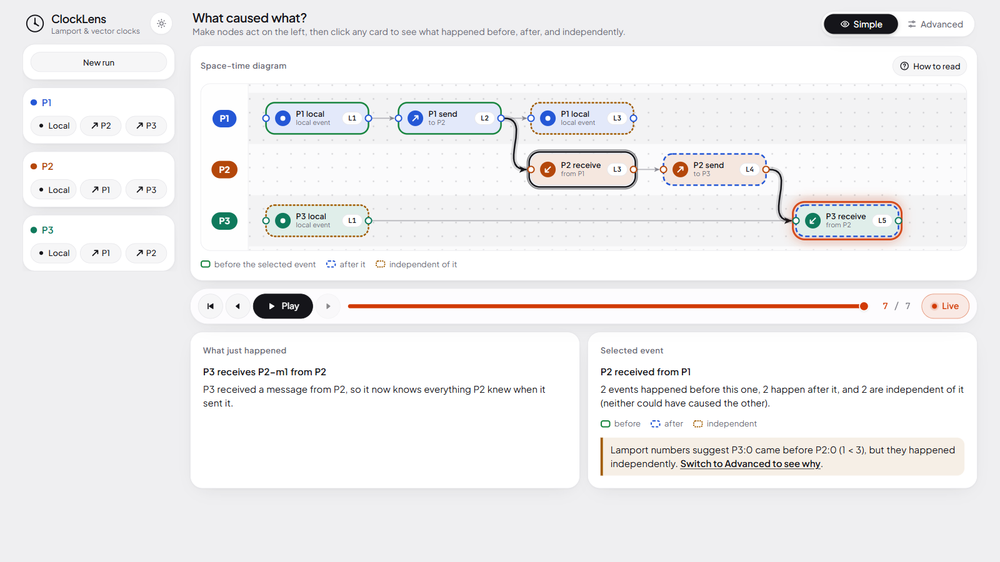
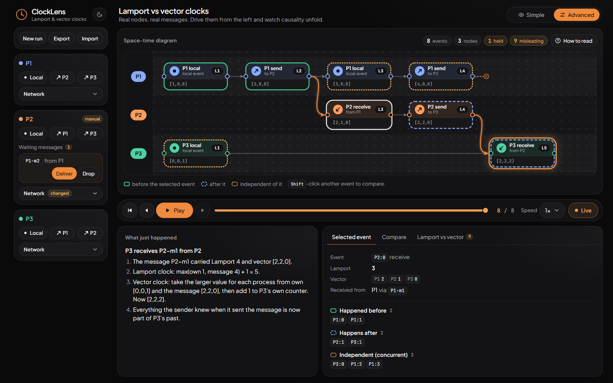

# ClockLens

**See what caused what in a distributed system.**

ClockLens is an interactive visualizer for Lamport and vector clocks. You drive real
nodes from a web UI — trigger local events, send messages, hold or drop them, cut links
between nodes — and watch the resulting events appear on a live space-time diagram.
Click any event to see what happened before it, what happens after it, and what was
independent of it, and find out exactly where Lamport timestamps would mislead you.

Nothing here is scripted or simulated. Every event comes from a real node process that
keeps its own clocks and talks to the others over NATS.



*Simple view (light theme): click an event to see what came before it, after it, and independently of it.*



*Advanced view (dark theme): vector clocks on every card, manual message delivery, and detailed causality panels.*

## Features

- **Real nodes.** Each node is its own Go process with its own Lamport and vector clock.
- **Live space-time diagram.** One lane per node, one card per event, arrows for messages.
- **Causality at a click.** Select an event and every other event is marked as *before*
  (solid outline), *after* (dashed) or *independent* (dotted).
- **Compare any two events.** Get a verdict (`before`, `after`, `equal`, `concurrent`) with a
  step-by-step proof and the chain of messages that connects them.
- **Lamport vs vector.** See every pair of concurrent events whose Lamport numbers still
  suggest an order — the reason vector clocks exist.
- **Create concurrency on demand.** Hold messages (manual delivery), deliver them in any
  order, drop them, or disconnect two nodes entirely.
- **Playback.** Replay a run step by step, or follow it live.
- **Simple and Advanced views.** Simple tells the story in plain English; Advanced adds
  clock values, comparisons and network controls.
- **Light and dark themes**, keyboard-accessible controls.
- **Import and export** a run as a JSON trace.

## Quick start

You need [Docker](https://docs.docker.com/get-docker/) with Compose.

```bash
docker compose up --build
```

Then open **http://localhost:3000**.

This starts NATS, the central server, three nodes (P1, P2, P3) and the web app.
For running without Docker, see [docs/setup.md](docs/setup.md).

### Try it: make Lamport mislead

1. Press **Local** on P1 twice, and **Local** on P3 once. The three events never exchanged a message.
2. Switch to **Advanced** (top right) and open the **Lamport vs vector** tab.
3. ClockLens reports a pair: P3's event has Lamport value 1 and P1's second event has 2, so
   Lamport suggests P3 came first — yet the events are *concurrent*. Press **Compare** to see
   the vector-clock proof.

## Documentation

| Document | What is in it |
|---|---|
| [docs/setup.md](docs/setup.md) | Install, run with or without Docker, configuration, troubleshooting |
| [docs/usage.md](docs/usage.md) | A tour of the UI: controls, diagram, comparison, playback |
| [docs/concepts.md](docs/concepts.md) | Lamport clocks, vector clocks and happened-before, in plain terms |
| [docs/architecture.md](docs/architecture.md) | Components, message flow, ordering rules, design decisions |
| [docs/api.md](docs/api.md) | REST endpoints, WebSocket stream and NATS subjects |
| [docs/development.md](docs/development.md) | Repo layout, conventions, testing, how to extend |
| [contracts/README.md](contracts/README.md) | The event schema and clock test vectors (source of truth) |

## How it fits together

```
Web UI (Next.js) ──REST / WebSocket──▶ Central server (Go) ──NATS──▶ Nodes P1, P2, P3 (Go)
```

The **web app** only sends commands and draws events; it computes no clocks. The **server**
turns UI commands into node commands, collects node events, and answers causality
questions. The **nodes** own the clocks. Events are ordered only by their clock values —
never by arrival order or wall time. See [docs/architecture.md](docs/architecture.md).

## Repository layout

| Path | Responsibility |
|---|---|
| `apps/web` | Next.js viewer: controls, diagram, playback, causality, comparison |
| `packages/events` | TypeScript types for `ClockEvent` and the wire protocol |
| `contracts/` | Event JSON schema and clock test vectors (source of truth) |
| `go/pkg/clock` | Lamport and vector clocks, `Compare` |
| `go/pkg/events` | Go `ClockEvent` struct and validation |
| `go/pkg/protocol` | NATS subjects, messages, control commands, status |
| `go/pkg/bus` | `Bus` interface with NATS and in-memory implementations |
| `go/internal/server/*` | Central server: api, run, orchestrator, hub, store, causality |
| `go/internal/node` | Node behaviour: clocks, delivery mode, held messages, partitions |
| `go/cmd/server`, `go/cmd/node` | The two Go binaries |
| `go/e2e` | End-to-end tests running server and nodes together |
| `deploy/`, `docker-compose.yml` | Container images and the `docker compose up` stack |

## Tests

```bash
make test        # Go and TypeScript
make test-go     # cd go && go test ./...
make test-ts     # pnpm test
```

## Tech stack

Go 1.26 · NATS (core pub/sub) · Next.js 15 · React 19 · TypeScript · Tailwind CSS 4 · pnpm workspaces · Docker Compose
